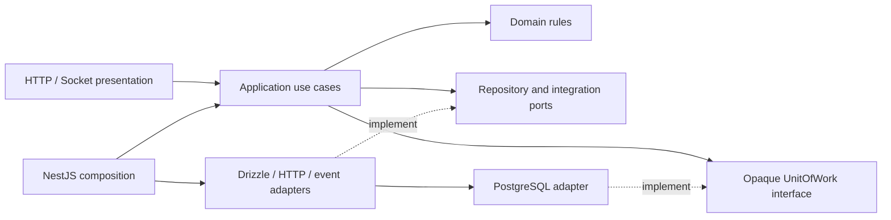

# Module ownership and migration ledger

See ADR-0030. The approved refactor is implemented and locally verified as of 2026-11-09; evidence and remaining model-training gates are recorded in the [verification report](../07-testing/architecture-refactor-verification.md).

| Owner | Tables | Application responsibilities |
| --- | --- | --- |
| Identity | identity_accounts, identity_sessions | Credentials, session rotation/revocation, account identity |
| Profile | profiles | Display name and timezone |
| Preferences | account_preferences | Preferences and forest arrangement |
| Camp | camps, camp_memberships, camp_invites, camp_invite_declines | Ownership, membership and invitations |
| Pact | focus_pacts, focus_pact_participants, pact_reminder_receipts | Pact lifecycle, participation and reminder claims |
| Focus | focus_sessions, session_participants | Start/join/checkout, active-slot uniqueness, expiry and presence state |
| Seed | open_seeds | Current private return draft |
| Memory | camp_milestones, personal_milestones | Durable derived milestones and authorized projections |
| Analytics | product_events | Redacted events, atomic daily Assistance quota and interaction ownership |
| Assistance | None | Capability policy, provider orchestration and fixed fallback |
| Presence | None | Socket transport for authorized Focus projections |
| Privacy | None | Coordinate owner-provided export and deletion operations |

## Critical transaction families to preserve

- Identity rotation: revoke previous token, clean expired sessions and insert replacement atomically; publish revocation only after success.
- Camp membership/invitation mutations: retain Camp row lock, invitation/membership locks and owner checks.
- Pact creation: retain actor advisory lock, Camp lock and eligibility checks. Pact start shares its transaction with the Focus session write.
- Focus start/checkout/expiry: retain active-slot uniqueness, Camp → session → participant locking where currently present, terminal-state idempotency, Seed writes and shared milestone creation.
- Analytics quota: retain global advisory lock `(639104, 1)`, then global/account UTC counts and reservation insertion.
- Preferences/Memory: retain account locking and milestone projection/arrangement eligibility.
- Privacy deletion: retain Camp ownership transfer/removal and account deletion in one transaction; publish account revocation after commit.

### Isolation and commit details verified in the existing code

- `FocusService.snapshot` reconciles expiry before entering its `repeatable read` transaction, then rechecks authorization inside it. `recentPartners` also uses `repeatable read`. The shared `UnitOfWork` accepts explicit isolation while preserving the driver's default when omitted.
- `FocusService.checkout` locks Camp (when applicable), session, then the current participant. A supplied Open Seed is written in that transaction; an omitted value leaves it unchanged, and `null` deletes it. A repeated checkout does not write it again.
- Camp milestone derivation occurs **after** the lifecycle transaction commits. It inserts with conflict suppression and records analytics only for a newly inserted milestone. Preserve this placement rather than moving it into checkout during refactoring.
- A Pact expiry branch returns a marker from the transaction and raises conflict after commit, preserving the expiry write. By contrast, the existing invitation-accept expiry branch throws inside its transaction; refactoring must not silently change its rollback behavior.
- Identity session rotation revokes the old hash, deletes expired sessions and inserts the replacement within one transaction. The revocation notification and cookie write occur only after that transaction resolves.

## Migration status

The first slice introduces a framework-independent shared kernel and use cases for Assistance, Analytics, Profile and Seed. Identity now separates credentials/session policies from cookies, HTTP, cryptography and SQL; Presence and Privacy consume its application interface. Camp separates membership/invitation policy from SQL and token generation, with NestJS factory composition. Pact separates creation, responses, expiry, reminders and archive orchestration from its repository; Camp updates and invitation revocation go through Camp's application port in that transaction. Focus now separates pure session orchestration from its repository, event channels, HTTP controller and 30-second maintenance timer. Presence is a Socket.IO presentation adapter using Identity, Focus and Preferences ports. Memory and Preferences also use pure application services with repositories and Identity account-lock access; Privacy now orchestrates owner-provided export and removal ports without SQL or framework imports.

Camp infrastructure retains two read-model JOINs to Profile: member display names and invitation-preview inviter names. These are read-only schema exceptions; no Profile write occurs in Camp. Camp invitation pagination retains millisecond truncation and its actor/Camp-bound cursor. Membership mutation locks, invitation expiry rollback, and analytics after commit retain their prior order.

Pact infrastructure retains read-model JOINs to Camp/membership for inbox, upcoming and due-reminder eligibility, and to Profile for participant display names. Reminder claims retain the Preferences row lock before selecting due pacts, inserting conflict-suppressed receipts and checking Pact status again. That Preferences read/lock now executes through the Preferences owner port, with the same transaction context; Pact neither reads its table directly nor writes it. Pact's actor advisory lock still precedes the Camp lock during creation, and Camp locks precede authorization and Pact locks for response/cancellation.

All schema and concrete-service exports have been removed from public module interfaces. `apps/api/scripts/schema-access.json` inventories the 20 existing infrastructure schema edges by source, target, named imports and purpose (foreign key or read model). This replaces the transitional public-export ledger; it does not authorize additional cross-owner access. The boundary checker rejects unlisted edges, stale entries, changed named imports, public schema exports, and direct Drizzle/interpolated-SQL writes to imported foreign tables. Raw SQL and indirect aliases still require code review; the checker is not a general SQL analyzer.

Privacy exports Profile, Preferences, Seed, Camp, Pact, Focus and Memory through owner ports. Raw stored preference fields and the absence of a preference row are preserved. Export remains the existing sequence of independent reads, not a newly introduced snapshot transaction. Deletion still verifies the password first, locks all owned Camps, chooses the earliest active successor, promotes/transfers or deletes each Camp, and deletes the account in the same transaction. Existing foreign-key cascades perform dependent deletion; account-deletion events occur only after commit.

The pre-refactor diff, untracked source copies and checksum manifest are saved locally in `.git/pyneath-refactor-baseline/`. They include the Local AI work that existed before this refactor; never restore HEAD over that work. Contracts, prompts and migrations are checked against this baseline, not against the earlier Git commit.

## Dependency inventory after completion

Recomputed from relative TypeScript imports on 2026-11-09. Includes type-only, composition and schema references; these edges are not claims of runtime calls. Empty placeholder modules are omitted. Apparent module-level reciprocal references do not imply a source-level runtime cycle; source graph checks pass.

| Module | Other module dependencies |
| --- | --- |
| analytics | identity |
| assistance | analytics |
| camp | analytics, identity, profile |
| focus | analytics, camp, identity, memory, pact, preferences, profile, seed |
| identity | None |
| memory | camp, focus, identity |
| pact | analytics, camp, identity, preferences, profile |
| preferences | identity, memory |
| presence | focus, identity, preferences |
| privacy | camp, focus, identity, memory, pact, preferences, profile, seed |
| profile | identity |
| seed | identity |

## Implemented dependency direction

The backend follows this dependency direction. Web and ML boundaries, browser workflows and API container verification have also passed the checks recorded in the verification report. Static checks cannot prove arbitrary indirect SQL aliases or computed Python imports; these still require code review.

## Focus, Memory and Preferences migration details

- Focus repository writes only Focus tables. Pact transitions use Pact ports, checkout Seed writes use Seed ports, and shared milestone creation uses Memory after commit. The existing unique-constraint handling, Camp → session → participant lock order, expiry, repeated-checkout behavior and two repeatable-read projections are preserved.
- Focus read-model exceptions: Profile display names, Preferences presence visibility, Camp active membership, and Pact invitees who have not joined. Its revoked-participant UPDATE writes only `session_participants`; the nested membership query remains a read of Camp data.
- Memory read-model exceptions: Focus completion history for personal projection, and Camp/membership for authorized shared history. The personal projection takes the Identity account lock first and inserts only newly earned 1/3/7 milestones with original completion timestamps.
- Preferences takes the same Identity account lock for forest arrangements, reads earned thresholds through Memory, checks the submitted version before saving, and publishes sharing notifications only after successful persistence. Pact reminder claims use `PreferencesAccess.lockReminders` in the caller's transaction.
- All module-owned repositories in composition share the singleton PostgreSQL unit of work. Test fixtures now cache one transaction owner per fixture database as well.
