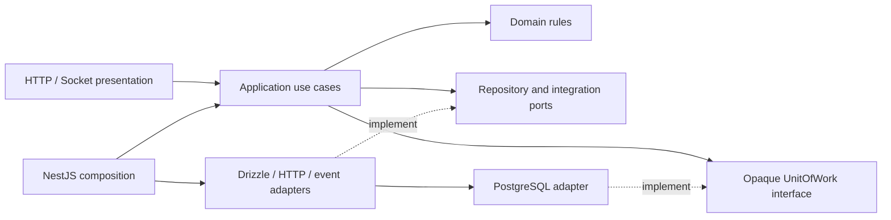

# Module ownership and migration ledger

See ADR-0030. This is an implementation ledger, not a statement that migration is complete.

| Owner | Tables | Application responsibilities |
| --- | --- | --- |
| Identity | identity_accounts, identity_sessions | Credentials, session rotation/revocation, account identity |
| Profile | profiles | Display name and timezone |
| Preferences | account_preferences | Preferences and forest arrangement |
| Camp | camps, camp_memberships, camp_invites, camp_invite_declines | Ownership, membership and invitations |
| Pact | focus_pacts, focus_pact_participants, pact_reminder_receipts | Pact lifecycle, participation and reminder claims |
| Focus | focus_sessions, session_participants | Start/join/checkout, active-slot uniqueness, expiry and presence state |
| Seed | open_seeds | Current private return draft |
| Memory | camp_milestones, personal_milestones | Durable derived milestones and authorized projections |
| Analytics | product_events | Redacted events, atomic daily Assistance quota and interaction ownership |
| Assistance | None | Capability policy, provider orchestration and fixed fallback |
| Presence | None | Socket transport for authorized Focus projections |
| Privacy | None | Coordinate owner-provided export and deletion operations |

## Critical transaction families to preserve

- Identity rotation: revoke previous token, clean expired sessions and insert replacement atomically; publish revocation only after success.
- Camp membership/invitation mutations: retain Camp row lock, invitation/membership locks and owner checks.
- Pact creation: retain actor advisory lock, Camp lock and eligibility checks. Pact start shares its transaction with the Focus session write.
- Focus start/checkout/expiry: retain active-slot uniqueness, Camp → session → participant locking where currently present, terminal-state idempotency, Seed writes and shared milestone creation.
- Analytics quota: retain global advisory lock `(639104, 1)`, then global/account UTC counts and reservation insertion.
- Preferences/Memory: retain account locking and milestone projection/arrangement eligibility.
- Privacy deletion: retain Camp ownership transfer/removal and account deletion in one transaction; publish account revocation after commit.

### Isolation and commit details verified in the existing code

- `FocusService.snapshot` reconciles expiry before entering its `repeatable read` transaction, then rechecks authorization inside it. `recentPartners` also uses `repeatable read`. The shared `UnitOfWork` accepts explicit isolation while preserving the driver's default when omitted.
- `FocusService.checkout` locks Camp (when applicable), session, then the current participant. A supplied Open Seed is written in that transaction; an omitted value leaves it unchanged, and `null` deletes it. A repeated checkout does not write it again.
- Camp milestone derivation occurs **after** the lifecycle transaction commits. It inserts with conflict suppression and records analytics only for a newly inserted milestone. Preserve this placement rather than moving it into checkout during refactoring.
- A Pact expiry branch returns a marker from the transaction and raises conflict after commit, preserving the expiry write. By contrast, the existing invitation-accept expiry branch throws inside its transaction; refactoring must not silently change its rollback behavior.
- Identity session rotation revokes the old hash, deletes expired sessions and inserts the replacement within one transaction. The revocation notification and cookie write occur only after that transaction resolves.

## Migration status

The first slice introduces a framework-independent shared kernel and use cases for Assistance, Analytics, Profile and Seed. HTTP adapters and repositories are composed by NestJS factories. Remaining flat modules are still pending migration.

`apps/api/scripts/legacy-module-exports.json` records remaining concrete/schema public exports. The boundary check rejects unlisted implementation exports and stale exceptions. This list must only shrink and must be empty when final module ownership is accepted. Profile/Seed schema exports currently remain because unconverted Focus/Privacy read and write them; those consumers must move to owner ports or explicitly inventoried infrastructure read models.

The pre-refactor diff, untracked source copies and checksum manifest are saved locally in `.git/pyneath-refactor-baseline/`. They include the Local AI work that existed before this refactor; never restore HEAD over that work. Contracts, prompts and migrations are checked against this baseline, not against the earlier Git commit.

## Dependency inventory after the first slice

Includes type-only and schema references; these edges are not claims of runtime calls. Recompute when subsequent modules migrate.

| Module | Other module dependencies |
| --- | --- |
| access | None |
| analytics | identity |
| assistance | analytics |
| camp | analytics, identity, profile |
| capture | None |
| consent | None |
| engagement | None |
| focus | analytics, camp, identity, memory, pact, preferences, profile, seed |
| habit | None |
| identity | None |
| memory | camp, focus, identity |
| pact | analytics, camp, identity, preferences, profile |
| preferences | identity, memory |
| presence | focus, identity, preferences |
| privacy | camp, focus, identity, memory, pact, preferences, profile, seed |
| profile | identity |
| reflection | None |
| seed | identity |
| task | None |

## Target dependency direction

The dependency direction above is the migration target. Flat modules and legacy exports in the inventory still require conversion before this structure can be claimed project-wide.
