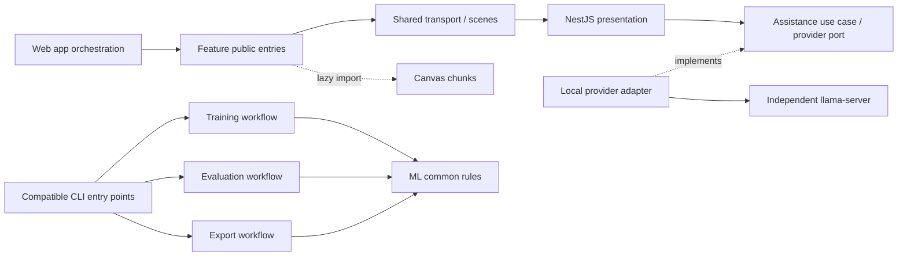

# Repository Structure

```text
apps/api/src/
  modules/<owner>/         domain, application, infrastructure, presentation, public-api.ts
  platform/               NestJS/PostgreSQL adapters; no business-module imports
  shared/kernel/          Pure transaction, errors, clock, event and pagination interfaces
apps/web/src/
  app/                    Session/route orchestration and application rendering
  features/<feature>/     Product behavior with explicit public/control/scene entry points
  shared/                 HTTP transport/clients, auth, realtime and shared forest rendering
packages/contracts/       Client-independent schemas/types; unchanged during refactor
ml/
  common/                 Protocol, dataset, checksum, config, manifest and checkpoint rules
  authoring/              Unreviewed candidate generation
  training/               Training-specific preflight and QLoRA workflow
  evaluation/             Predictions, human review, scoring, selection and measurement
  export/                 Exact-base conversion and evidence-bound promotion
  scripts/                Compatible commands, protocol bridges and architecture checks
  notebooks/              Thin private Colab workflow
services/inference-service/serving/
                          Standalone pinned llama-server launcher and runbook
```

Backend composition wires framework-independent use cases to owner repositories. Cross-module application calls use typed ports and one opaque transaction context. The [ownership ledger](module-ownership.md) records table owners, transaction ordering and public surfaces; exact existing foreign-key/read-model schema edges are inventoried in `apps/api/scripts/schema-access.json`. Public module exports contain no Drizzle schema or concrete service.

Web features access other features through explicit entry points. Shared scene rendering owns no Camp/Focus/Memory business state. The Camp canvas adapter supplies Memory growth through a rendering slot; canvas and Three.js remain lazily loaded. `useAppSession` and `useAssistance` own orchestration, while components render the existing product experience.

Offline ML workflows depend on `ml/common`, not on one another's CLI or training helpers. Documented CLI paths and arguments remain available. The unused FastAPI experiment, its dependency declaration and the orphaned Maven wrapper configuration were removed after a reference audit under [ADR-0030](adr/0030-module-ownership-refactor.md). Local environments, private data and weights were not removed. Historical verification reports remain evidence of their original date.

No v2 model has passed release gates. The opt-in local provider calls llama-server directly; no inference gateway is added. See the [local AI runbook](../05-machine-learning/local-ai-runbook.md). The approved architecture refactor passed local workspace, PostgreSQL, browser and container checks on 2026-11-09; see the [verification report](../07-testing/architecture-refactor-verification.md) for evidence and limits. The target mobile client still requires its own approved platform and authentication decisions.


