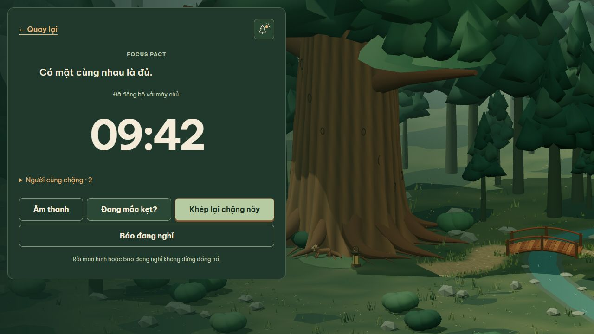

# Security remediation verification — 2026-11-02

Status: local implementation and integration verification passed, with five reviewed JavaScript development dependency exceptions and a separate Python follow-up. No deployment, push or existing database changes were performed. Work used one agent and preserved the pre-existing UI/ML changes.

## Implemented behavior

- Realtime validates the PostgreSQL session and original socket account before protected reads/writes and server pushes. Logout/rotation/account deletion disconnect affected sockets, expiry has an independent timer, and shutdown clears listeners/timers. Established sockets receive `UNAUTHENTICATED` or `SERVICE_UNAVAILABLE` before disconnect.
- Web session expiry uses the existing login/draft policy. Service failures retry HTTP/reconnect at a bounded interval. Switching auth mode clears local errors, form values and visible-password state; late results from the previous form generation cannot repopulate the new mode. Parent connection errors remain visible.
- CORS permits `PUT` and `Idempotency-Key` while retaining the configured origin and CSRF protection. Compressed JSON is refused with HTTP 415 / `UNSUPPORTED_MEDIA_TYPE`; malformed and oversized JSON keep safe errors and the 32 KB limit.
- Milestone export uses an active-membership SQL join. Removed memberships retain history with current Camp name/status set to `null`; private session data remains available.
- Zod 4.6.7 is shared by contracts/API, Vitest is 5.0.5, Vite is 7.3.7, Drizzle Kit is 0.31.11 and Nest runtime/testing stays on major 11 (11.2.8). Scoped compatible overrides address the listed transitive fixes.
- Zod compatibility tests preserve normalized email, password bounds, strict objects, legacy UUID shape, minute/second datetime precision and colonless offsets. `z.guid()` and a date-checked legacy datetime schema avoid silently tightening the wire contract. Configuration uses v4 IPv4/IPv6 validators. Reviewed [Zod migration guidance](https://zod.dev/v4/changelog) and [Vitest migration guidance](https://vitest.dev/guide/migration/); Node >=22.12 is required.

## Verification results

| Check | Result | Evidence |
| --- | --- | --- |
| `pnpm lint` | Passed, including 71-file API boundary/cycle check | [lint log](evidence/security-2026-11-02/lint.txt) |
| `pnpm build` | Passed contracts/API/web | [build log](evidence/security-2026-11-02/build.txt) |
| Web suite | 68 passed across 17 files | [workspace tests](evidence/security-2026-11-02/workspace-tests.txt) |
| API suite | 50 passed, 3 opt-in live HTTP entrypoints skipped in this invocation | Same log; those HTTP suites ran separately below |
| PostgreSQL suites | Identity/migration, core flow, assistance quotas and privacy export all actually ran | Same log, named PostgreSQL subtests |
| Live HTTP integration | 24 passed, 0 failed, 0 skipped | [HTTP log](evidence/security-2026-11-02/http-tests.txt) |
| Realtime revocation + privacy transaction regression subset | 14 passed, 0 skipped | [targeted regression log](evidence/security-2026-11-02/security-regressions.txt) |
| Audit gate regression | 2 passed | Workspace test log |
| Container build | Passed with frozen lockfile and production deployment bundle | [container build log](evidence/security-2026-11-02/container-build.txt) |
| Audit policy | Passed; no unreviewed findings | [gate output](evidence/security-2026-11-02/audit-gate.txt) |

The API count includes the four real PostgreSQL suites. The three skipped HTTP entrypoints in `pnpm test` are deliberate separation from the separately executed sequential HTTP command, not missing integration coverage. HTTP coverage is Camp invite (8 subtests), Pact (8), Solo (5), plus their three parent tests.

Required regression cases include multiple sockets per session, another valid session of the same account, logout, rotation, idle expiry, account deletion, changed account identity, database revocation without internal events, database lookup failure on subscribe/heartbeat/presence, suppressed server snapshot/presence pushes, lost Camp access, reconnect and terminal snapshots. Export tests cover active/removed/rejoined members, outsiders, milestones created after removal, retained private sessions, wrong-password rejection and failed-transaction notification suppression.

HTTP tests cover valid/foreign CORS origins and command preflights, normal/malformed/oversized JSON, gzip/deflate/br rejection and a subsequent healthy API request. Auth cookie test clients now retain the named `PYNEATH_SESSION` cookie instead of overwriting it with a legacy-cookie deletion response.

## Browser verification

The in-app Chromium browser used only fictional accounts under `example.test`. API provider integration was disabled. Web ran on `127.0.0.1:15173`, API on `127.0.0.1:18081`.

| Scenario | Observed result |
| --- | --- |
| Auth mode reset | Mismatched registration confirmation displayed its error; switching to login emptied the form, removed the local error and reset the password toggle. |
| Parent connection error | With API stopped, the connection warning stayed visible across login/register changes. After API recovery, Retry cleared it and registration succeeded. |
| Same-origin proxy | Register → timezone → Solo → reload/reconnect → checkout with Seed → Camp creation → invitation creation → second-account registration and invitation acceptance succeeded. |
| Pact | Two accounts created/accepted a Pact. Starting through the cross-origin API produced a synced realtime session. Joining and reload were verified again on a restored fixture: two participants, same session and synced state. |
| Cross-origin commands | Login, Solo start, Pact start/join and Seed `PUT` worked with credentials, CSRF and browser preflights. |
| Session expiry | Expiring only a fictional account's session in the disposable DB caused the active realtime page to switch to login. Another account could log in; access still required its own Pact join. |
| API outage/recovery | Stopping only the test API displayed disconnected state and disabled presence controls. Restarting it against the same database automatically restored synced state with both participants. |
| Export | Download completed through Settings. JSON contained the saved Seed and the account's session intention; file content was checked and the temporary download removed. See [asserted export facts](evidence/security-2026-11-02/browser-export-check.json). |

The browser checks above are manual tool-driven regression evidence; the realtime retry/expiry state machine additionally has automated tests in `useSessionRealtime.test.ts`. This is Chromium local testing, not a Safari/Firefox or mobile-device certification.

## Dependency audit

The approved audit baseline was 37 JavaScript warnings. The final registry audit reports **5**: 4 moderate and 1 low, with **0 high/critical**. The production-only JavaScript audit reports **0**. This count does not include the separate Python environment finding below.

- [Full final registry output](evidence/security-2026-11-02/pnpm-audit.json)
- [Production-only output](evidence/security-2026-11-02/pnpm-audit-production.json)
- [Exact exception policy](../../scripts/audit-exceptions.json), expiring **2026-12-02**. Each entry specifies advisory, package, version, dependency path, severity, scope, exploit conditions, mitigation, owner and removal condition. A new path/version/severity, unknown advisory, expired exception, malformed response or registry failure fails CI.

| Exception | Exact version/path under `apps__api` | Reason for remaining |
| --- | --- | --- |
| [GHSA-67mh-4wv8-2f99](https://github.com/advisories/GHSA-67mh-4wv8-2f99) | `drizzle-kit → @esbuild-kit/esm-loader → @esbuild-kit/core-utils → esbuild 0.18.20` | Drizzle Kit still uses this loader; vulnerable serve mode is unused. No incompatible esbuild override. |
| [GHSA-gcqx-w48m-w2h4](https://github.com/advisories/GHSA-gcqx-w48m-w2h4) | `@nestjs/cli → fork-ts-checker-webpack-plugin → deepmerge 4.3.1` | Advisory has no published patched version; only trusted build configuration is merged. |
| [GHSA-g3hv-75wg-m249](https://github.com/advisories/GHSA-g3hv-75wg-m249) | `@nestjs/cli → fork-ts-checker-webpack-plugin → minimatch 3.1.5` | Reported fix requires major 11; major-3 callable API is incompatible. |
| Same minimatch advisory | `@nestjs/cli → glob → minimatch 10.2.6` | Wait for compatible parent update; build patterns are trusted. |
| [GHSA-3g3m-2fjr-6pw4](https://github.com/advisories/GHSA-3g3m-2fjr-6pw4) | `@nestjs/cli → glob 13.0.6` | Fix requires major 14; bounded trusted checkouts and CI timeout mitigate continued traversal after cancellation. |

The patched branches include body-parser 2.4.0, proxy-addr 2.0.8, multer 2.5.0, qs 6.16.1, source-map-js 1.2.2, fast-uri 3.1.9 and brace-expansion fixes scoped to compatible minimatch parents. Old test-runner tinypool/esbuild branches were removed via the parent upgrade. The one retained old esbuild branch is explicitly listed above.

Python: 27 installed distributions scanned in a temporary audit environment; **one unique critical certifi advisory**, duplicated in the tool's raw result. No inference/ML changes were made. See the [separate follow-up](python-dependency-followup-2026-11-02.md) for affected version, dependency path, exploit conditions and upgrade recommendation.

## Isolation, CI and reproducibility

Docker Desktop was available. Created only `pyneath-security-test-20261102`, PostgreSQL 17 Alpine, label `pyneath.audit=20261102`, database `pyneath_security_test`, a random host port bound to `127.0.0.1`, and tmpfs storage without a pre-existing volume. The initial port was 59663. During a deliberate service interruption the tmpfs DB was lost on stop; its new port was inspected (49545), the empty target verified and existing migrations reapplied. All subsequent database URLs were explicitly updated. A privacy test interrupted by that stop was rerun successfully. No existing database was used as fallback.

An initial concurrent test compile removed an output file while HTTP tests were running; final commands ran sequentially. These harness failures were not hidden by skips. After the temporary DB reset, browser fixtures were recreated using the UI/HTTP API, and join/reconnect was reverified. Final evidence files contain successful reruns.

CI now audits dependencies, requires PostgreSQL configuration/connectivity before running the workspace tests, and executes Solo/Pact/Camp invite HTTP suites sequentially after migration/readiness. `check-test-database.cjs` was verified to fail without its URL and pass against the disposable service. `run-http-tests.cjs` requires all three live-test environment values, local targets, migrated identity tables and a ready API. The GitHub-hosted workflow itself was not triggered; local lint/build/tests and the container build were exercised.

To rerun, create a new isolated PostgreSQL 17 database, set `PYNEATH_TEST_DATABASE_URL`, run the preflight and `pnpm test`; set `API_DATABASE_URL` to that same new database for migration/start. Then set `PYNEATH_SOLO_API_URL`, `PYNEATH_SOLO_DATABASE_URL` and `PYNEATH_SOLO_WEB_ORIGIN` and run `node apps/api/scripts/run-http-tests.cjs`. Compile tests before the HTTP runner, and do not run a cleanup/recompile concurrently with it.

Cleanup: test PostgreSQL container/image and API/web listeners were removed/stopped. Automatic approval review blocked recursive deletion of the temporary Python audit directory; that one non-running directory remains for manual cleanup. See [cleanup evidence](evidence/security-2026-11-02/cleanup.txt) for the exact path and rejection.

## Files and remaining limits

Changed implementation: API identity service/public API, presence gateway, privacy service, HTTP parser/error configuration, API config and cursor validation; web AuthView and realtime hook; shared ID/datetime/assistance contracts. Updated manifests/lockfile/workspace overrides and CI. Added/updated regression tests, audit scripts/policy, integration preflights, this report, data-rights policy and [ADR-0025](../04-engineering/adr/0025-realtime-session-revocation.md).

Existing Forest UI assets/components and ML dataset edits remain outside this remediation; do not revert them when rolling back. Rollback should reverse only this change's hunks and matching manifest/lockfile updates. No business migration was added.

Build warnings remain for Zod package comment annotations and the existing large 3D web chunk; they do not fail the build and are not security advisories. PostgreSQL fixture tests emit a pg deprecation warning for concurrent queries on one client; current pg 8 tests pass. Immediate revocation notifications are process-local, as documented in ADR-0025. No production, multi-instance load, external model, OS-image vulnerability or browser-engine matrix testing is claimed.
